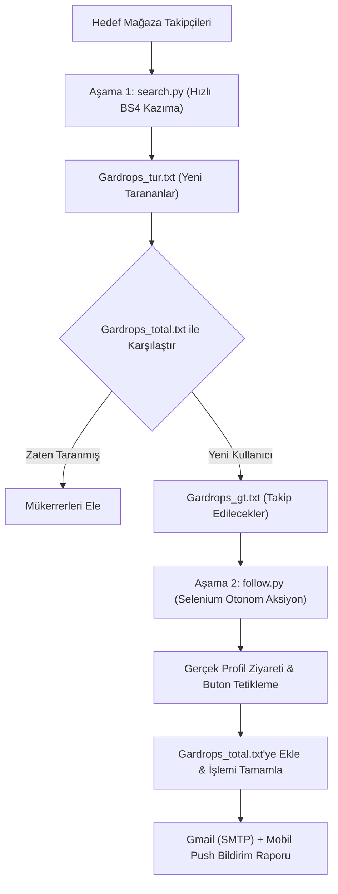

# 🛍️ Gardrops Otonom Pazaryeri & Akıllı Takip Suite (2022 Arşivi)

> 📅 **Tarihçe & Geliştirme Notu:** Bu proje, **2022 yılında** e-ticaret pazaryerinde (Gardrops) organik mağaza etkileşimini artırmak, geri takip (follow-for-follow) süreçlerini otonomlaştırmak ve platformun o dönemki teknik altyapı bug'larını aşmak amacıyla geliştirilmiş hibrit (BeautifulSoup4 + Selenium) otomasyon çalışmasıdır.

---

## 🔍 Platformdaki Sorun Neydi? (Adım Adım Hata Analizi)

2022 döneminde Gardrops web arayüzünde mağazasını büyütmek isteyen satıcıların önünü tıkayan **3 kritik teknik hata ve mimari darboğaz** bulunmaktaydı:

### ❌ 1. Hata: Takipçi Durumunun Tersine Dönmesi (DOM & State Desync Bug'ı)
* **Adım 1:** Bir kullanıcının `gardrops.com/{kullanıcı}/followers` (takipçiler) sayfasına girilir.
* **Adım 2:** Sayfa aşağı kaydırılarak (infinite scroll) yeni yüklenen kullanıcıların yanındaki **"Takip Et"** butonuna basılır ve kullanıcı takip edilir.
* **Adım 3:** Sayfadan çıkılıp veya sayfa yenilenip aynı kullanıcının takipçiler listesine tekrar gelindiğinde, platformun frontend durum eşitleme (DOM cache) hatası nedeniyle **daha önce takip edilen kullanıcılar hala "Takip Et" (takip edilmiyor) şeklinde görünür.**
* **Sonuç:** Kullanıcı profiline doğrudan girildiğinde aslında kişinin takip edildiği anlaşılır; fakat liste üzerinde durum güncellenmediği için manuel işlem yapan satıcılar sürekli aynı kişilere mükerrer takip/takipten çıkma döngüsüne girer ve platform tarafından geçici işlem engeli (rate limit / ban) alırdı.

### ❌ 2. Hata: 3030 Kullanıcı Listeleme Sınırı (Pagination Hard-Limit)
* Gardrops web altyapısı, bir profilin kaç bin takipçisi olursa olsun sonsuz kaydırmada en fazla **3030 kullanıcıya** kadar DOM elemanı yüklemekteydi.
* Sayfa sayacı `3030` değerine ulaştığında kaydırma dursa bile geriye kalan potansiyel binlerce alıcıya web arayüzünden erişmek imkansız hale geliyordu.

### ❌ 3. Hata: Saf Selenium'un Aşırı Yavaşlığı & CPU Tüketimi
* Binlerce kullanıcının profilini yalnızca Selenium ile DOM üzerinden gezip çekmek saatler sürmekte, tarayıcı aşırı bellek tüketip kilitlenmekteydi.

---

## 💡 Mühendislik Çözümü & Algoritma Mimarisi

Yukarıdaki darboğazları aşmak için sistem **2 ayrı fazda (Search & Follow)** ve **diferansiyel dosya önbellekleme** mantığıyla kurgulanmıştır:



### 1. Diferansiyel Yerel Önbellekleme (`Lists/` Mantığı):
* Platformdaki durum hatasını (State Desync) bertaraf etmek için web arayüzünün "Takip Edildi" etiketine **güvenilmemiştir**.
* Bunun yerine bot kendi yerel durum tablosunu tutar:
  * `Gardrops_tur.txt`: O anki oturumda taranan ham kullanıcılar.
  * `Gardrops_total.txt`: Bugüne kadar işlem yapılmış tüm benzersiz kullanıcı havuzu.
  * `Gardrops_gt.txt`: İki liste arasındaki fark kümesi (Set Difference). Sadece **daha önce hiç temas kurulmamış** kişilere istek gönderilir.

### 2. Hibrit Performans Yaklaşımı (BS4 + Selenium):
* **Hızlı Kazıma (`search.py`):** BeautifulSoup4 ve Requests kullanılarak DOM'dan kullanıcı isimleri saniyeler içinde kazınır.
* **Otonom İşlemci (`follow.py`):** Yalnızca filtrelenmiş temiz listeye Selenium ile girilerek insan hareketleri simüle edilir.

### 3. Çok Kanallı Bildirim Sistemi (SMTP & Mobil Push):
* Bot oturumu tamamladığında geliştiricinin başında beklemesine gerek kalmadan:
  * **Gmail (SMTP):** İşlem özeti ve kaç kişiye ulaşıldığı mail olarak atılır.
  * **Mobil Push Bildirimi:** Telefona anlık durum bildirimi düşer.

---

## 📁 Dosya Yapısı

```text
Gardrops-Otomasyon-Botu/
├── search.py          # Hızlı BeautifulSoup4 kullanıcı kazıma motoru
├── follow.py          # Selenium otonom profil takip motoru
├── search_main.py     # Kazıma başlatıcı
├── follow_main.py     # Takip başlatıcı
├── kullanici.py       # Kullanıcı giriş, hedef mağaza ve sayaç ayarları
├── bildirim.txt       # Mobil push bildirim servis konfigürasyonu
├── Lists/             # Diferansiyel önbellek listeleri (txt)
├── requirements.txt   # Python kütüphaneleri
└── README.md          # Bu dokümantasyon
```

---

## 🚀 Kurulum & Çalıştırma

### 1. Bağımlılıkları Yükleyin:
```bash
pip install -r requirements.txt
```

### 2. Yapılandırma:
`kullanici.py` dosyasını açıp bilgilerinizi ve hedef mağaza adını girin:
```python
# kullanici.py
hesap_sayac = 0
# Takipçilerini taramak istediğiniz mağazalar:
user = ["ornek_magaza_1", "ornek_magaza_2"]
```

### 3. Çalıştırma Sırası:
```bash
# Adım 1: Hedef mağazaların takipçilerini hızla kazıyın:
python search_main.py

# Adım 2: Ayrıştırılan filtrelenmiş kullanıcılara takipleri başlatın:
python follow_main.py
```

---

## ⚠️ Arşiv & Sorumluluk Reddi
*Bu yazılım 2022 yılındaki Gardrops web DOM mimarisi ve arayüz kısıtları incelenerek eğitim ve otomasyon algoritmaları araştırma amacıyla paylaşılmıştır.*
